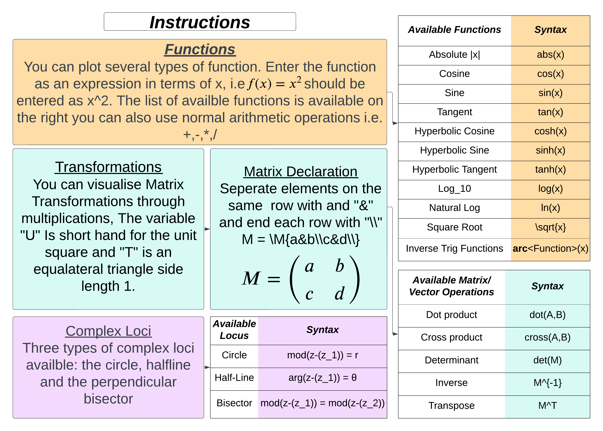

# Graphy McGraphFace

[](https://github.com/B-M-0/Interface/actions/workflows/build.yml)

A desktop maths visualiser for A-level Further Maths topics, written in C# with WPF. You type an expression, it's rendered as typeset LaTeX as you type, and the result is plotted or evaluated live.

I built it as my A-level Computer Science coursework (NEA) project. The expression parser, the evaluator and the number types (rationals, surds, complex numbers, matrices and vectors) are written from scratch. The only libraries are ScottPlot for the plot canvas and WpfMath for LaTeX rendering.

## Features

| Mode | What it does |
| --- | --- |
| **Real functions** | Plot up to three functions of `x` at once. Vertical asymptotes are detected and drawn as dotted red lines. |
| **Transformations** | Visualise 2×2 matrix transformations applied to the unit square `U` or an equilateral triangle `T`. |
| **Calculate** | Evaluate expressions **exactly**, as fractions and surds rather than floating-point approximations. It also handles complex numbers (with a modulus–argument form toggle), matrices (determinant, inverse, transpose) and vectors (dot and cross product). |
| **Argand diagram** | Plot complex loci: circles `\|z − z₁\| = r`, half-lines `arg(z − z₁) = θ` and perpendicular bisectors `\|z − z₁\| = \|z − z₂\|`. |

You can also choose radians, degrees or gradians, and pick from 16 plot themes.



## How it works

```
text input ──► FormatInput ──► InfixToPostfix ──► EvaluatePostfix ──► plot / LaTeX output
               (tokenise,      (shunting-yard)    (stack machine over
                implicit ×)                         the number types)
```

- **`InputHandling.cs`** tokenises the input and converts it from infix to postfix with the shunting-yard algorithm. It then evaluates the postfix expression on a stack, with separate evaluators for real, complex/exact and matrix arithmetic. It also classifies complex loci equations.
- **`Rational.cs` and `Surd.cs`** do exact arithmetic. Results stay as fractions and surds where possible, with the decimal value shown alongside.
- **`ComplexNumber.cs`** handles complex arithmetic and converts to modulus–argument form.
- **`Matrix.cs`, `SquareMatrix.cs` and `Vector.cs`** handle matrix and vector algebra, including determinant, inverse, transpose, dot product and cross product.
- **`Function.cs`** wraps a parsed postfix expression so it can be evaluated repeatedly, for example once per x-value while plotting.
- **`MainWindow.xaml(.cs)`** is the WPF UI. It manages page navigation, live LaTeX previews and plotting with ScottPlot.

## Running it

You need Windows, because WPF only runs there, and the .NET 6 SDK or later.

```bash
git clone https://github.com/B-M-0/Interface.git
cd Interface
dotnet run --project Interface
```

Or open `Interface.sln` in Visual Studio and press F5.

## Example inputs

| Mode | Input |
| --- | --- |
| Functions | `x^2 - 3*x + 2`, `tan(x)`, `1/(x-2)` |
| Transformations | `\M{2&0\\0&1\\} U` |
| Calculate | `\sqrt{12} + \sqrt{27}`, `(3+4i)*(1-2i)`, `det(\M{1&2\\3&4\\})` |
| Argand diagram | `mod(z-(2+i)) = 3`, `arg(z-(1)) = \pi/4` |

## Tech

C# · .NET 6 · WPF · [ScottPlot](https://scottplot.net/) · [WpfMath](https://github.com/ForNeVeR/wpf-math)
